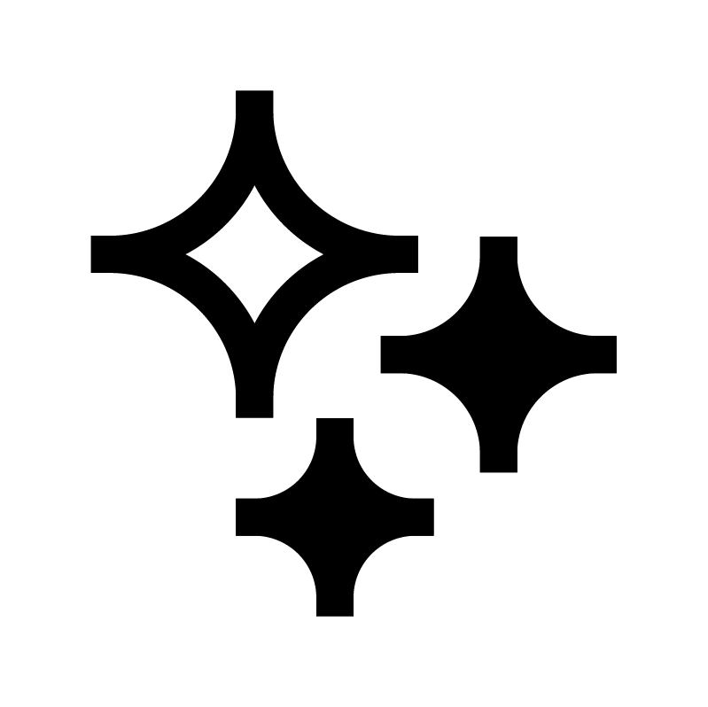
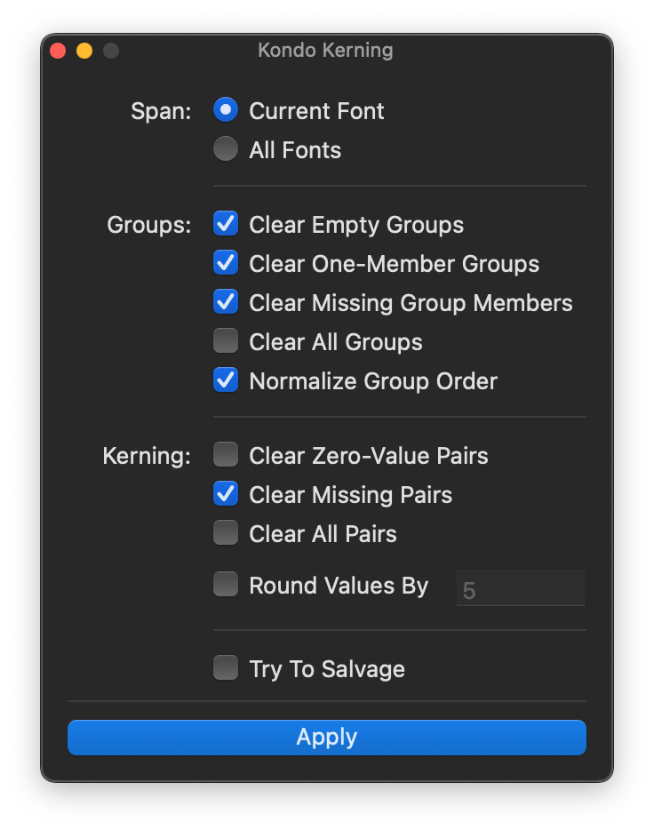

# Kondo Kerning
A RoboFont extension for cleaning up kerning and group data in your UFOs.

## A tour of the interface

### Span
Choose whether you’d like to affect just the current, frontmost UFO or all open UFOs.

### Clear

#### Empty Groups

Check this if you would like to remove any group that has no members.

#### One-Member Groups

Check this if you would like to remove any group that has only one member. Kerning pairs involving that group name will be replaced with the glyph name instead.

#### All Groups

> Warning: Destructive!

Check this if you would like to remove all groups.

#### Missing Group Members

Check this if you would like to remove any glyph names from a group if they are not present in the font.

---

#### Zero-Value Pairs

Check this if you would like to remove any pair that has a value of zero.

#### All Pairs

> Warning: Destructive!

Check this if you would like to remove all kerning pairs.

#### Missing Pairs

Check this if you would like to remove all pairs in which one or both of the glyphs involved are missing from the font.

#### Try To Salvage

> Note: Experimental.

Check this if you would like to attempt to salvage kerning data when the Missing Pairs operation is applied. Currently, this assumes a group name is involved, and intuits a glyph name from the group name if the glyph is in the font. (e.g. `public.kern1.a.alt` → `a.alt`)

### Round

Check this if you would like to round the kerning values to a particular value. Choose the value by which you would like to round it.

### Apply

This button will do all the work! See a detailed report in the [Output Window](https://robofont.com/documentation/reference/workspace/output-window/) afterward.

## Acknowledgements

Built with RoboFont & EZUI. Thanks to Frederik Berlaen & Tal Leming.
